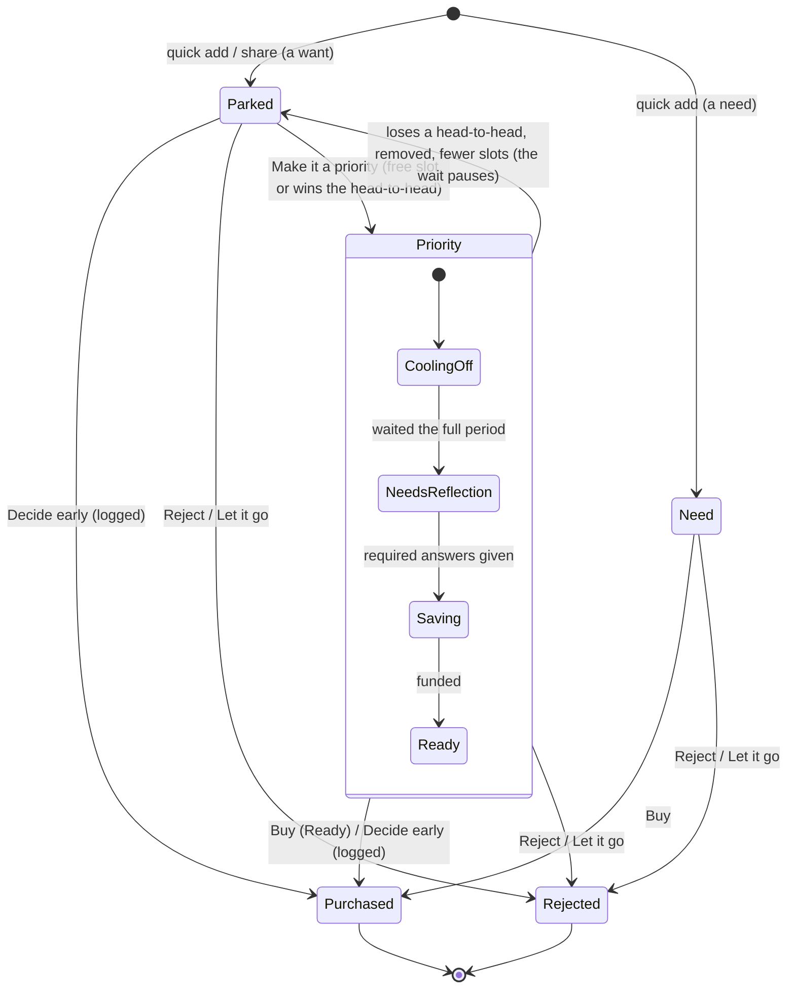

# Product brief

> Working name: **Before You Buy** (final name not decided — see "Open decisions").
> Status: planning complete for MVP, no code yet. Last updated: 2026-10-04.

## 1. One sentence

A source-available Android app that makes people **pause, reflect, prioritize and deliberately save** for purchases before they buy them.

## 2. Philosophy

> **Don't prevent people from buying things. Help them make sure the purchase is actually worth it.**

The app sits between *"I want this"* and *"I'm buying this"* and adds deliberate, kind friction.

The app **does**:

- make intentional purchases easier and impulse purchases slightly harder
- make opportunity cost visible ("what else could this money do?")
- make the user compare competing wants instead of evaluating each one in isolation
- help the user learn from their own past decisions

The app **does not**:

- prevent, shame or moralize spending
- optimize for spending as little as possible ("better spending, not maximum frugality")
- behave like a shopping platform, show deals, or encourage browsing
- connect to banks or move real money (all money in the app is an *earmark*, not an account)

It is **not primarily a budgeting app**. The budget exists only to support purchase decisions.

## 3. Target user

Someone who wants many (often expensive) things at the same time and can't reasonably afford all of them — e.g. "camera, 3D printer, bicycle upgrade". Two problems:

1. impulse purchases
2. too many competing wants

The question the app asks is not *"Can I afford this?"* but **"Is this the best use of my money compared with everything else I want?"**

Launch market: English + German UI, EUR default (any single currency selectable).

## 4. Core concepts

### 4.1 Item

Anything the user is considering buying.

| Field | Required | Notes |
|---|---|---|
| Name | yes | |
| Price | yes | Integer minor units + the app's currency. Shown in whole units, rounded (`20 €` for 19,99 €, ADR-0034) |
| Link (URL) | no | Usually from the share sheet |
| Image | no | From photo picker; copied into app storage. **De-emphasized** while cooling off (see §6) |
| Category | no | Free text or simple list |
| Notes | no | |
| Kind | yes | `WANT` (default) or `NEED` (see 4.4) |
| Date added | auto | |
| Time waited | auto | Calendar days the want has spent in a priority slot (see 4.2); starts at 0 |
| Target purchase date | no | Informational only |
| Reflection answers | later | See 4.3 |
| Allocated savings | derived | Sum of allocations |
| Priority slot | no | 1..N if the item is an active priority. A want without one is *parked* (shown as "Wishlist", see 4.7) |

### 4.2 Cooling-off period

Every `WANT` gets a waiting period based on its price. Defaults (user-configurable in Settings):

| Price | Waiting period |
|---:|---:|
| < 100 | 7 days |
| 100 – < 500 | 30 days |
| 500 – < 1,000 | 60 days |
| ≥ 1,000 | 90 days |

Rules:

- **The waiting period runs only while the want holds a priority slot** (4.7, ADR-0049). A new want is always parked on the wishlist, with no timer running. Its wait starts when it gets a slot: directly while one is free, otherwise by winning the head-to-head.
- The app keeps how long the want has waited, in calendar days. **Losing a slot pauses the wait, it never resets it** (a lost head-to-head, "Remove from priorities", fewer slots): the time already waited is kept, and the wait continues the next time the item gets a slot. The wait is complete once the time waited reaches `period(price)`. A priority shows its end date; a parked want has none.
- **Editing the price can only extend, never shorten** the period: `period = max(current, period(newPrice))`. (Prevents gaming by entering a low price first.)
- Changing the tier settings changes the period of every want whose wait isn't complete, longer or shorter, to `period(price)` under the new tiers; the time already waited stays (ADR-0031, ADR-0049). A complete wait stays complete.
- A need has no waiting period (4.4).
- *"Wanting something immediately does not make it immediately purchasable."*

### 4.3 Reflection

Capture must be fast (name + price, ~10 seconds). Reflection happens **after** capture: the app nudges the user to answer within the first days, and an item **cannot become Ready until the required questions are answered.**

Questions (research: listing reasons *for and against* reduces impulse urge — see `research.md`):

| Question | Required for Ready |
|---|---|
| Why do you want this? | yes |
| How often will you use it? (picker: daily / weekly / monthly / rarely / once) | yes |
| Reasons **against** buying it | yes (at least one) |
| What problem does it solve? | no |
| What do you use now instead? | no |
| What will it replace? | no |
| Why now? | no |
| Upgrade or genuinely new? | no |

Answers are shown again on the decision screen — this creates the separation between *initial excitement* and *final decision*.

### 4.4 Need fast path

A user can mark an item as `NEED` (e.g. "fridge broke"). A need:

- skips the cooling-off period and reflection requirement
- goes straight to the decision screen
- is recorded in history as a need (so the user can later see whether "needs" were really needs)
- counts as funded and is **never** drawn from the discretionary pool, which is for fun things; there is no budget for needs (ADR-0044). Something paid from fun money is recorded as a want

Without this path users stop using the app for "real" purchases.

### 4.5 Discretionary pool (monthly allowance)

Manual, no bank connection.

- The user sets a **monthly allowance** (e.g. 300 €) and an accrual day (default: 1st).
- The pool grows automatically each month — no upkeep required. Optional starting balance and manual adjustments (+/−) with a note.
- `pool = startingBalance + accruals + adjustments − spentFromPool`
- `committed = sum of allocations to active items`
- `unallocated = pool − committed` (shown prominently; may never go below zero through allocation)

Example: *Fun money for wants 300 € · Set aside for wants 200 € · Not yet set aside 100 €*. Never "available" or "spend" (ADR-0045). First credit, catch-up and changes: ADR-0045.

### 4.6 Savings per item (earmarks)

Any **priority** can receive allocations from the unallocated pool ("put 100 € toward the camera"). Saving can start **as soon as the want holds a slot, in parallel with its waiting period.** A parked want can be reflected on but not saved for, so fun money goes to items the user chose (ADR-0049). Needs never receive any (ADR-0044).

- Allocation is limited by `unallocated`; more than the price is allowed (a holiday with a minimum budget), buying returns what isn't spent. "Take back" returns money from an item.
- Money already set aside on an item that loses its slot stays with it; nothing is taken back silently, and "Take back" still works. No new money can be set aside until it holds a slot again.
- Reject → allocations return to unallocated.
- Buy → allocations are consumed; if the actual price differs, the difference is taken from / returned to unallocated. Going below zero asks first; the purchase is the one ledger entry (ADR-0046).
- A want turned into a need gives its allocations back (the user confirms).
- "Wants need their price set aside" (on the fun money screen, on by default): when off, or while fun money isn't set up, funding isn't required for Ready (ADR-0046).
- Shown as "650 € of 1,600 € set aside · 950 € to go"; never "saved".

### 4.7 Priorities

- **N active priority slots**, configurable 1–5, **default 3**, the same for any price.
- The wishlist itself has no limit, so capture stays fast. **Only priorities wait, can be set aside for and can be Ready** (ADR-0049). A new want is always added to the wishlist and has to be made a priority first.
- If a free slot exists, a want can simply be promoted. That starts its wait.
- If all slots are full, the want must **earn its place via head-to-head comparison**: the app shows it next to each current priority (price, reasons, usage, saved amount) and asks *"Which would you rather have?"*. Losing items move back to the wishlist and their wait pauses; ranks are updated by the outcomes.
- Ranks exist only for priorities; wishlist items have none.
- Rationale: joint (side-by-side) evaluation leads to more considered choices than evaluating each item alone (see `research.md`).

## 5. Lifecycle

The original linear idea (*Idea → Cooling Off → Considered → Saving → Ready → Purchased/Rejected*) was revised: **waiting and saving run in parallel, for priorities.** Only a want that holds a priority slot waits, so only priorities can be Ready (ADR-0049).

An active item has four conditions:

- `parked` — a `WANT` without a priority slot (never true for `NEED`)
- `cooledOff` — time waited ≥ `period(price)` (always true for `NEED`)
- `reflected` — required reflection answers present (always true for `NEED`)
- `funded` — allocations ≥ price, in whole units as shown (always true for `NEED`, ADR-0044, and while funding isn't required, ADR-0046)

The **displayed stage** is derived, never stored. `parked` is checked first and wins over every other stage:

| Stage | Condition |
|---|---|
| Parked (shown as "Wishlist") | parked |
| Cooling off | holds a slot, not cooledOff |
| Needs reflection | holds a slot, cooledOff, not reflected |
| Saving | holds a slot, cooledOff, reflected, not funded |
| **Ready** | holds a slot, cooledOff, reflected, funded |

A parked want is never Ready, however long it has waited. A `NEED` is Ready at once.

Terminal statuses (stored): `PURCHASED`, `REJECTED` (= "Decided against").

Reflection answers can be given at any time, parked or not; money can be set aside while the want holds a slot. So a priority may go straight from *Cooling off* to *Ready* the moment its timer ends, and a want that has already waited its full period is Ready the moment it is promoted and its answers (and money, where required) are in. *Wait* keeps the item active with a re-check date.

Decisions:

- **Buy** — available when Ready (a priority) or for `NEED`. Records actual price and date.
- **Buy anyway (early)** — available any time but behind deliberate friction: type a reason, see the opportunity cost, confirm. Logged as `earlyPurchase = true` and visible in history/stats. (Soft lock, chosen 2026-10-04.) It is the only way to buy a parked want: instead of the days left it says that the item isn't one of the priorities and how much of its waiting period is done (not started / N of M days / done).
- **Wait** — sets a re-check date (e.g. 7 / 30 days); item stays active.
- **Reject / Let it go** — moves to "Decided against". Never deleted (user may delete explicitly).

## 6. Screens (MVP)

### 6.1 Home / dashboard — answers four questions

1. **What am I considering?** — priorities + wishlist count
2. **What can I decide on?** — Ready priorities and needs (and priorities whose cooling-off just ended); never a parked want (ADR-0049)
3. **What am I saving for?** — priority goals with progress; money is set aside only for priorities (ADR-0049)
4. **How much discretionary money do I have?** — available / committed / unallocated

The "decided against" total is **not** shown next to Ready items (moral licensing — see `research.md`).

### 6.2 Quick add

Bottom sheet: name + price (+ optional link, kind = want/need). Saving takes ≤ 10 seconds. Opens prefilled from the share sheet.

For a want, a quiet line under the price shows its tier as the price is typed: *"Waiting period: 90 days, once it's a priority"*. A need keeps *"Needs skip the waiting period"*. A new want is always added to the wishlist: the snackbar says *"Added to your wishlist."* with a **"Make it a priority"** action (a free slot at once, otherwise the head-to-head). After share capture the toast says the same without an action (ADR-0049).

### 6.3 Wishlist & item detail

Three sections: **Priorities** (by rank, each with its stage: Cooling off / Needs reflection / Saving / Ready / Looking again later), **Needs** (if any; Ready at once) and **Wishlist** (every parked want: no stage, no rank, nothing counting down). A parked want's detail and decision screen say *"Not one of your priorities"* and offer **"Make it a priority"** (ADR-0049). Item detail leads with **the user's own reasons and the countdown**, not the product photo (image small/collapsed while cooling off). There is **no prominent "open in shop" button** while cooling off — browsing during a delay defeats it (research). The link is still accessible (e.g. overflow menu / copy link).

### 6.4 Reflection

Short, one question per step, skippable except required ones. "Reasons against" is a list the user can add to.

### 6.5 Decision screen

Shows: price · how long they've wanted it · cooling-off completed (or how much is left, for early; for a parked want, that it isn't a priority and how much of its wait is done) · amount saved · original reasons (for & against) · expected usage · what it replaces · other priorities · effect on the discretionary pool · **opportunity cost**.

Then asks: **"Do you still want to spend this money on this?"** — Buy / Wait / Reject, with Reject visually equal to Buy.

The not-buying option is labelled concretely, e.g. *"Keep 1,200 € for your Camera (#2)"* (research: describing the alternative reduces impulse purchases).

### 6.6 History

Two tabs: **Bought** and **Decided against**.

- Bought: price, date, original price, time considered, original reason, early/need flag.
- Decided against: total shown as *"You decided against 3,420 € of purchases"* — neutral, no trophies, streaks, confetti or "you saved!" language.

### 6.7 Settings

Currency · monthly allowance & accrual day · starting balance / adjustments · cooling-off tiers · priority slots · notifications · export/import · language (follows system, per-app language supported).

## 7. Opportunity cost

Shown on the decision screen and item detail. Computed in the pure domain layer. Examples for a 1,200 € item:

- *= 75 % of your Bike upgrade goal*
- *= 4 months of your discretionary allowance*
- *Buying this delays your #2 priority by ~3 months* (based on allowance rate)
- *= your 3 smallest wishlist items combined*

MVP shows the simplest two (months of allowance, other priorities); the rest follows in M2. Order, needs, the delay estimate and the "Don't buy" label: ADR-0048.

## 8. Notifications

Encourage reflection, never consumption. A daily background check (WorkManager), at most one digest-style notification per day. Only priorities are notified about: parked wants are left alone on purpose (ADR-0049).

Allowed:

- *"You've wanted the camera for 61 days. Your cooling-off period is over."* — actions: **Still want it** / **Let it go**
- *"Take 1 minute to note why you want the 3D printer."* (reflection nudge, ~day 2)
- *"You decided against 430 € of purchases this month."* (monthly, opt-in)

Never:

- *"You have money available!"*, deal/price alerts, product suggestions, anything that resembles a shop.

The explicit "Let it go" action is deliberate: in the *one sec* study the option to dismiss was the most effective element.

## 9. Privacy & data

- Local only, no account, no server, no analytics, no ads.
- **MVP ships without the `INTERNET` permission.** Shared links are parsed offline (title + URL from the share text). This enables the store claim *"This app cannot send your data anywhere."* CI enforces it.
- Backup: export/import a versioned JSON file + Android Auto Backup / device-transfer rules.

## 10. Scope & milestones

| Milestone | Goal | Content |
|---|---|---|
| **M0 Foundation** | A buildable, tested, CI-checked empty app | Cloud env/SDK, project scaffold, CI, theme & i18n |
| **M1 Core loop** | Usable for the creator's own purchases | Domain model, cooling-off engine, persistence, quick add, share capture, wishlist/detail, reflection, decision screen (basic opportunity cost), history, notifications, dashboard |
| **M2 Money & priorities** | The differentiators | Allowance pool, per-item savings & Ready, priorities + head-to-head, full opportunity cost |
| **M3 Release** | Google Play closed test → production | Settings, export/import, onboarding, German copy, accessibility, privacy policy, name/ID/account decisions, store listing & release pipeline |
| **Later** | v1.x | Home-screen widget, "Was it worth it?" check-in & insights, opt-in link previews, cost in hours worked, monetization |

Capture methods: share sheet + manual quick add (M1), home-screen widget (Later).

## 11. Decisions

All decisions are recorded as ADRs in [`docs/decisions/`](decisions/README.md) (index there). Changing a decision means a new superseding ADR, not editing this brief silently.

## 12. Open decisions

- **Final app name and logo** — #31 (descriptive names are hard to register as EU word marks — see `research.md`)
- **Google Play account type** — #34 — personal (12 testers × 14 days closed test) vs organization (D-U-N-S, exempt)
- **Monetization model** — #41 — and with it EU DSA trader status (public address) and German business registration
